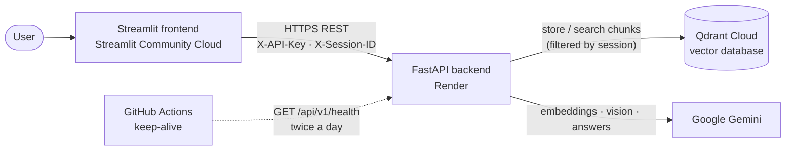

<div align="center">

# 🤖 Enterprise Multi-Document RAG Platform

**Ask questions about your own documents — PDFs, Word, PowerPoint, Excel, text and images — and get answers grounded only in them, streamed live with page-level citations.**


[](https://github.com/AkshithKalvakota/Enterprise-RAG-platform/actions/workflows/keep-alive.yml)

**[🚀 Live App](https://enterprise-rag-platform-ip8elc4rcvtw89ssqsuy2s.streamlit.app/)** · **[📘 API Docs](https://enterprise-rag-assistant-6n3h.onrender.com/docs)**

</div>

> **Note:** the backend runs on Render's free tier and sleeps after ~15 minutes without traffic. The first request after that can take up to a minute while it wakes up — the app shows "Waking up server…" meanwhile.

---

## 📌 What It Does

Large language models make things up when they don't know an answer, and they know nothing about your private files. This platform uses **Retrieval-Augmented Generation (RAG)**: it first finds the relevant passages in *your* documents, then has the model answer **only from those passages** and cite where each answer came from.

**Example**

> 📄 Upload `travel_policy.pdf`
> 💬 *"What is the hotel limit per night?"*
> 🤖 *"4500 rupees per night."*
> `📄 Sources: travel_policy.pdf (page 2)`
>
> 💬 *"Who owns it?"* → the follow-up is understood as *"Who owns the travel policy?"*
> 🤖 *"Priya Raman, Finance."*

---

## ✨ Features

### 📂 Document ingestion
- **Many formats:** PDF, DOCX, PPTX, XLSX, CSV, TXT, Markdown.
- **Images:** PNG, JPG and WebP (screenshots, scanned pages, charts, diagrams) are read by Gemini Vision, which transcribes visible text and describes the content — including chart values.
- **Structure-aware parsing:** PDFs page by page, slides one by one, **every** Excel sheet, and Word **tables** as well as paragraphs.
- **Clear feedback:** files with no extractable text (e.g. scanned PDFs) are reported per file instead of failing silently.

### 💬 Answers
- **Grounded answers:** the model may only use the retrieved passages, and says *"I cannot answer this based on the provided documents"* otherwise.
- **Source citations:** every answer lists the file and page, slide or sheet it actually used.
- **Follow-up questions:** questions like *"what about her department?"* are rewritten into standalone questions using the chat history before searching.
- **Streaming:** answers appear word by word as they are generated.

### 🔐 Security & privacy
- **Per-session isolation:** every chunk is tagged with the user's session ID, and every search and delete is filtered by it — users never see each other's documents.
- **API-key authentication** between the frontend and backend.
- **Rate limiting:** 30 requests per minute per session (HTTP `429` beyond that).
- **Upload validation:** path stripping (`../../file.pdf` stays inside the session folder), file-type allow-list, size limits.
- **Prompt-injection guarding:** document text is wrapped in `<documents>` tags and declared untrusted, so instructions hidden inside files are not followed.
- **Automatic cleanup:** documents older than 24 hours are deleted, so abandoned sessions don't pile up.

### ⚡ Reliability
- **Fail fast, then fall back:** each Gemini call gets 2 attempts with a 30 s timeout; if the primary model is overloaded, the request moves to a second model automatically.
- **Retrying embeddings:** chunks are embedded in batches of 50 with exponential backoff that respects the provider's suggested retry delay.
- **Keep-alive monitoring:** a scheduled GitHub Actions workflow checks the vector database twice a day, keeping the free cluster active and emailing the owner if the check fails.

---

## 🏗️ Architecture



| Component | Technology | Hosted on | Responsibility |
|:--|:--|:--|:--|
| Frontend | Streamlit | Streamlit Community Cloud | Upload, chat, streaming display, citations |
| Backend | FastAPI + Uvicorn | Render | Security, parsing, chunking, retrieval, generation |
| Vector store | Qdrant | Qdrant Cloud (AWS us-east-1) | Stores chunk vectors + metadata, filtered similarity search |
| AI | Google Gemini | Google | `gemini-embedding-001` embeddings, `gemini-3.5-flash-lite` answers and vision, `gemini-3.1-flash-lite` fallback |

The frontend never imports backend code — it only knows the REST contract, so either side can be replaced independently. The backend is layered **routes → services → database**, and `database/vector_store.py` is the only module that talks to Qdrant.

---

## 🔄 How It Works

### Ingestion
1. The frontend wakes the backend (`GET /status`) and clears the session's previous documents (`DELETE /session`).
2. Files are uploaded (`POST /upload`), validated, and saved to a folder for that session.
3. `POST /index/{file}` parses the file into segments that remember their **page, slide or sheet**; images are sent to Gemini Vision.
4. Segments are split into **1000-character chunks with 200 characters of overlap**, each tagged with `source`, location, `session_id` and `indexed_at`.
5. Chunks are embedded with `gemini-embedding-001` (3072 dimensions) and stored in Qdrant.

### Question answering
1. `POST /query/stream` receives the question and recent chat history (last 6 messages).
2. Follow-up questions are rewritten into standalone questions.
3. Qdrant returns the **top 5** most similar chunks (cosine similarity, HNSW index) **from this session only**.
4. The numbered, labelled chunks are placed inside `<documents>` tags in a strict prompt.
5. Gemini answers and ends with a `SOURCES: 1, 3` line; the backend turns those numbers into citations and hides the line from the user.
6. The answer streams back as NDJSON events and is rendered live.

---

## 🧰 Tech Stack

| Area | Tools |
|:--|:--|
| Language | Python 3.11 |
| Backend | FastAPI, Uvicorn, Pydantic |
| Frontend | Streamlit, Requests |
| RAG & LLM | LangChain (text splitter, Gemini & Qdrant integrations, model fallbacks), Google Gemini |
| Vector database | Qdrant Cloud |
| Parsing | PyMuPDF, python-docx, python-pptx, pandas, openpyxl, Gemini Vision |
| Reliability & security | `limits` (rate limiting), `truststore` (OS certificate store) |
| Deployment & ops | Render, Streamlit Community Cloud, GitHub Actions |

---

## 📂 Project Structure

```text
Enterprise-RAG-platform/
├── .github/workflows/
│   └── keep-alive.yml        # Twice-daily health check of the backend and Qdrant
├── backend/
│   ├── main.py               # App setup, start-up tasks, exception handler, CORS, request logging
│   ├── routes.py             # API endpoints
│   ├── security.py           # API-key check, session-ID validation, rate limiting
│   ├── dependencies.py       # Shared Qdrant/Gemini clients, created once
│   └── cleanup.py            # Deletes documents older than SESSION_TTL_HOURS
├── database/
│   └── vector_store.py       # Qdrant access: collection setup, retrying embeddings, session-filtered search/delete
├── frontend/
│   ├── app.py                # Streamlit interface
│   └── requirements.txt      # Frontend dependencies (used by Streamlit Cloud)
├── services/
│   ├── document_parser.py    # Text extraction per format, with page/slide/sheet locations
│   ├── image_reader.py       # Gemini Vision: image → transcribed text + description
│   ├── chunker.py            # Recursive character chunking with metadata
│   ├── llm.py                # Shared Gemini setup (primary model + fallback)
│   └── rag_engine.py         # Query rewriting, retrieval, prompting, citations, streaming
├── utils/
│   ├── config.py             # All settings, read from environment variables
│   ├── retry.py              # Retry with backoff for busy/rate-limited Gemini calls
│   └── logger.py             # Logging setup
├── .env.example              # Every setting with its default
├── requirements.txt          # Backend dependencies (pinned)
└── runtime.txt               # Python version
```

---

## 🔌 API Reference

Interactive docs: **[`/docs`](https://enterprise-rag-assistant-6n3h.onrender.com/docs)**. All routes are under `/api/v1`.

Every route except `/status` and `/health` requires two headers:

```http
X-API-Key: <shared secret>           # required when API_KEY is set on the server
X-Session-ID: 9f2c41ab77d04e1c8a3b   # 8–64 chars: letters, digits, _ or -
```

| Endpoint | Method | Description |
|:--|:--:|:--|
| `/status` | `GET` | Liveness check; also used to wake the server |
| `/health` | `GET` | Verifies Qdrant is reachable (`503` if not) |
| `/upload` | `POST` | Multipart upload; validates names, types and sizes |
| `/index/{filename}` | `POST` | Parse → chunk → embed → store; `400` if no text can be extracted |
| `/query` | `POST` | Returns `{ "answer", "sources" }` |
| `/query/stream` | `POST` | Same as `/query`, streamed as NDJSON (used by the frontend) |
| `/session` | `DELETE` | Deletes the session's chunks and uploaded files |
| `/parse/{filename}` | `POST` | Debug: raw parser output |
| `/chunk/{filename}` | `POST` | Debug: chunk count and preview |

**Example**

```http
POST /api/v1/query
{ "question": "What is the hotel limit per night?", "chat_history": [], "top_k": 5 }
```
```json
{ "answer": "4500 rupees per night.",
  "sources": [{ "source": "travel_policy.pdf", "location": "page 2" }] }
```

**Streaming response** (`/query/stream`, one JSON object per line):

```json
{"type": "token", "text": "4500"}
{"type": "token", "text": " rupees per night."}
{"type": "done", "answer": "4500 rupees per night.", "sources": [{"source": "travel_policy.pdf", "location": "page 2"}]}
```

| Status | Meaning |
|:--:|:--|
| `400` | Invalid session ID, or no text could be extracted |
| `401` | Missing or wrong API key |
| `404` | File not uploaded in this session |
| `422` | Invalid request body (e.g. empty question, `top_k` outside 1–20) |
| `429` | Rate limit exceeded |
| `503` | Gemini busy after retries and fallback, or Qdrant unreachable |

---

## ⚙️ Configuration

All settings live in [`utils/config.py`](utils/config.py) and can be overridden with environment variables (see [`.env.example`](.env.example)).

| Variable | Default | Purpose |
|:--|:--|:--|
| `GOOGLE_API_KEY` | — | Gemini API key **(required)** |
| `QDRANT_URL`, `QDRANT_API_KEY` | — | Qdrant Cloud cluster (falls back to local storage if unset) |
| `API_KEY` | empty | Shared secret for the frontend; **auth is disabled if empty** |
| `LLM_MODEL` | `gemini-3.5-flash-lite` | Answer and vision model |
| `LLM_FALLBACK_MODEL` | `gemini-3.1-flash-lite` | Used when the primary model is busy (`""` disables) |
| `LLM_THINKING_LEVEL` | `low` | Gemini reasoning effort (`minimal`/`low`/`medium`/`high`) |
| `LLM_MAX_ATTEMPTS`, `LLM_TIMEOUT_SECONDS` | `2`, `30` | Attempts and timeout per model call |
| `EMBED_BATCH_SIZE`, `EMBED_MAX_ATTEMPTS` | `50`, `4` | Embedding batch size and retries |
| `CHUNK_SIZE`, `CHUNK_OVERLAP` | `1000`, `200` | Chunking (characters) |
| `DEFAULT_TOP_K`, `MAX_TOP_K` | `5`, `20` | Chunks retrieved per question |
| `MAX_HISTORY_MESSAGES` | `6` | Chat messages sent to the model |
| `RATE_LIMIT` | `30/minute` | Requests allowed per session |
| `MAX_UPLOAD_MB` | `20` | Upload size limit (images are capped at 14 MB) |
| `SESSION_TTL_HOURS`, `CLEANUP_INTERVAL_MINUTES` | `24`, `60` | Automatic deletion of old documents |
| `COLLECTION_NAME` | `enterprise_rag_docs` | Qdrant collection |
| `ALLOWED_ORIGINS` | empty | Comma-separated browser origins allowed by CORS |

Frontend settings (Streamlit secrets or environment variables): `API_KEY` (same value as the backend) and `BACKEND_URL` (defaults to the live Render backend).

---

## 🛠️ Running Locally

**Prerequisites:** Python **3.11** (newer versions such as 3.14 are not yet supported by LangChain), Git, a [Google AI Studio](https://aistudio.google.com/) API key, and optionally a free [Qdrant Cloud](https://cloud.qdrant.io/) cluster.

```bash
git clone https://github.com/AkshithKalvakota/Enterprise-RAG-platform.git
cd Enterprise-RAG-platform

python -m venv venv
source venv/bin/activate        # Windows: venv\Scripts\activate
pip install -r requirements.txt -r frontend/requirements.txt
```

Copy `.env.example` to `.env` and fill in at least:

```env
GOOGLE_API_KEY=your_google_ai_studio_key
QDRANT_URL=https://your-cluster.cloud.qdrant.io     # optional: omit to use local storage
QDRANT_API_KEY=your_qdrant_api_key                  # optional
API_KEY=any_long_random_string
```

Start the backend and the frontend in two terminals:

```bash
uvicorn backend.main:app --reload --port 8000
```
```bash
BACKEND_URL=http://localhost:8000 API_KEY=any_long_random_string streamlit run frontend/app.py
```

On Windows PowerShell, set the frontend variables first:
```powershell
$env:BACKEND_URL="http://localhost:8000"; $env:API_KEY="any_long_random_string"; streamlit run frontend/app.py
```

> If your antivirus scans HTTPS traffic (e.g. Avast), no extra setup is needed: the app uses the operating system's certificate store via `truststore`.

---

## ☁️ Deployment

| Service | Setup |
|:--|:--|
| **Backend — Render** | Build: `pip install -r requirements.txt` · Start: `uvicorn backend.main:app --host 0.0.0.0 --port $PORT` · Python 3.11 pinned (`runtime.txt` / `PYTHON_VERSION`) · Env: `GOOGLE_API_KEY`, `QDRANT_URL`, `QDRANT_API_KEY`, `API_KEY` |
| **Frontend — Streamlit Community Cloud** | Entry point `frontend/app.py` (installs `frontend/requirements.txt`) · Secrets: `API_KEY`, optional `BACKEND_URL` |
| **Database — Qdrant Cloud** | Free cluster; the collection and payload indexes are created automatically on first start |
| **Monitoring — GitHub Actions** | `keep-alive.yml` calls `/api/v1/health` at 03:17 and 15:17 UTC; can also be run manually from the Actions tab |

Pushing to `main` redeploys both the backend and the frontend.
**Rolling out a new API key without downtime:** set it in Streamlit secrets first, then on Render — the backend ignores the header until its own key is set.

---

## 🧠 Engineering Highlights

- **Latency: 65 s+ → 2–5 s.** Measuring each stage showed the time was spent in the model call: the model was overloaded (HTTP 503) and the SDK silently retried six times. Fixed by switching to a lighter model, reducing reasoning effort, reusing clients instead of rebuilding them per request, moving blocking work off the event loop, and adding fail-fast retries with a fallback model. With streaming, the first words now appear in about 1.5 s.
- **From a global reset to real multi-tenancy.** Stale documents leaking into answers was first handled with a global reset endpoint, which was unsafe for concurrent users. It was replaced by session-scoped storage enforced in every Qdrant query, scoped deletion, and a 24-hour TTL cleanup.
- **A rate limiter that silently did nothing.** The standard FastAPI rate-limiting library could not see routes in the FastAPI version used and skipped every limit without an error. A test that the *N+1*-th request returns `429` caught it; it was replaced with a small dependency built on the `limits` library.
- **Protecting a free managed dependency.** The free Qdrant cluster was once deleted after a period of inactivity. A scheduled health check now keeps it active and alerts on failure.

---

## ⚠️ Limitations & Roadmap

| Current limitation | Planned improvement |
|:--|:--|
| No automated test suite yet | Pytest for parsers, chunker, security and routes, run in CI on every push |
| Answer quality is checked manually | An evaluation set of questions with known answers, scored automatically |
| Sessions, not user accounts — closing the tab ends access | OAuth login, using the same isolation filter with a user ID |
| Semantic search only; exact codes (e.g. `INV-2041`) can be missed | Hybrid dense + keyword (BM25) search with a reranker |
| Scanned PDFs are not read | OCR for pages without a text layer |
| `.doc`, `.ppt`, `.xls` are not supported | Conversion to modern formats before parsing |
| Indexing runs inside the request; very large files may time out | Background ingestion jobs with progress reporting |
| Free-tier hosting: cold starts and API quotas | Paid tiers or containerised hosting |

---

## 👤 Author

**Akshith Kalvakota**
[GitHub](https://github.com/AkshithKalvakota)
